# Bytebase: một thay đổi mới từ Git tới Oracle

**Đã hoàn thành execution mới và đối soát đúng bảng POC.** Có 42 ảnh PNG thật. Bộ cũ `../bytebase-demo-screenshots/` giữ nguyên; không dùng execution cũ thay kết quả mới.

| Mắt xích | ID / kết quả thực tế |
| --- | --- |
| PR chính | [#9](https://github.com/devsecopslonghn/cr7allgoals-db/pull/9), đã merge 2026-10-22T07:25:39Z |
| Source SHA đã review | `ecfb13fb31a23036d7a8ee2ad9cc0c5c37039661` |
| Merge SHA | `a8267df4c8b097b67fa4b6e88da8bf82e8146d0c` |
| PR SQL Review | [PR-9 #2](https://jenkins.apps.drgdevlab.com/job/devsecopslonghn/job/cr7allgoals-db/job/PR-9/2/), SUCCESS, 0 ERROR / 3 WARNING |
| Build triển khai | [master #12](https://jenkins.apps.drgdevlab.com/job/devsecopslonghn/job/cr7allgoals-db/job/master/12/), SUCCESS, checkout merge SHA trên |
| Release | [release_20261022-RC00](https://bytebase.apps.drgdevlab.com/projects/cr7-allgoal-kvi1/releases/release_20261022-RC00) |
| Plan | [114](https://bytebase.apps.drgdevlab.com/projects/cr7-allgoal-kvi1/plans/114) |
| Task / task run | `114` / `113`, stage `develop`, Done |
| Target | `instances/oracle-cloud-free-sge0/databases/CR7ALLGOALS_APP` |
| Project / stage | `projects/cr7-allgoal-kvi1` / `environments/develop` |
| Identity thực thi | `jenkins@service.bytebase.com` |
| Migration / object | `V1.0.0.10` / `BB_POC_E2E_20261022_A` |
| Oracle đối soát | Query mới lúc 14:28:19 GMT+7, count = 0, 243 ms |
| Ca âm | [PR #10](https://github.com/devsecopslonghn/cr7allgoals-db/pull/10), SHA `743302007818e0410d3f353c326e87960115441b`, PR-10 #2 FAILURE, chưa merge/deploy |

Bytebase đang chạy **v3.22.1 / Community**: Subscription ghi Current plan Community, runtime action báo CLI/server đều 3.22.1. Không bật trial hoặc đổi license. Workflow dùng CI/CD có sẵn; sau merge, Jenkins tự rollout develop, không có màn hình chờ người bấm deploy được chứng minh.

SQL ở source SHA, merge SHA và Sheet trong Release giống nhau từng byte (932 bytes), SHA-256 `706ea32221e2d738a88bcb6a76db2f20c0e6e53e0a3db4295f2e4ad695446dcd`. Xem [results.md](results.md) và [artifacts](artifacts/).

Ảnh từ Chromium/Playwright thật, viewport 1600×1000; ảnh Jenkins dùng clip native 1600×940 để loại header thông tin tài khoản. Không sửa chữ/kết quả, tạo HTML mô phỏng hoặc xuất auth state. Vài ảnh phụ lục mở file/output Git thật dạng plaintext local, được ghi rõ và không thay cho ảnh GitHub. Mốc CSV dùng UTC; UI chủ yếu GMT+7.

## Luồng chính

### 01 — Jenkinsfile đang dùng trong repo

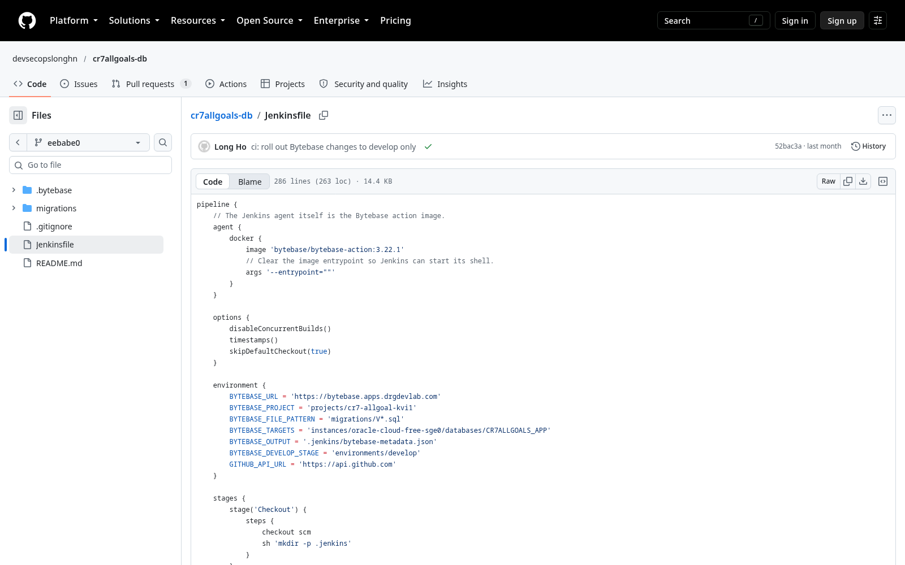

**Thao tác:** Mở Jenkinsfile tại base SHA eebabe0 trên GitHub.

**Quan sát:** Image bytebase/bytebase-action:3.22.1; target CR7ALLGOALS_APP; project cr7-allgoal-kvi1; pattern migrations/V*.sql; stage develop.

**Giới hạn:** Ảnh là source cấu hình. Đã đối chiếu Jenkins master #11 và các build PR mới; không dùng #11 làm execution của SQL mới.

**Lời trình bày:** Repo đã có pipeline để review PR và rollout develop sau merge. Phiên này dùng lại pipeline, không dựng Jenkins thay thế.

### 02 — Version trước thay đổi

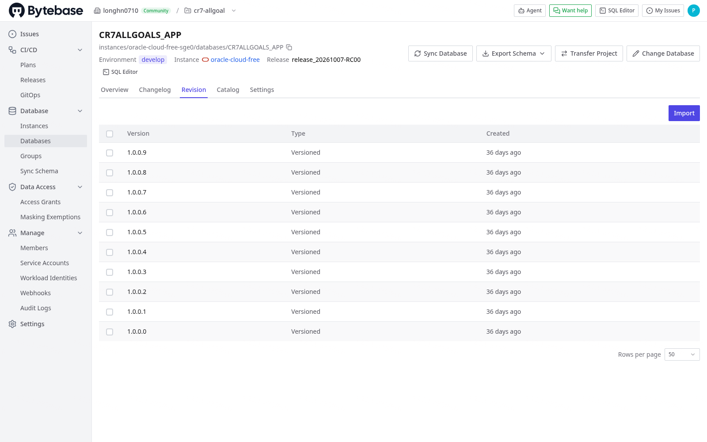

**Thao tác:** Database CR7ALLGOALS_APP → Revision.

**Quan sát:** Bytebase liệt kê revisions 1.0.0.0 đến 1.0.0.9, trong khi master chỉ chứa files tới V1.0.0.5; PR #8 có V6–9.

**Giới hạn:** Đây là baseline, không phải revision của thay đổi mới. Không import, repair hoặc xóa history để giải quyết lệch nguồn.

**Lời trình bày:** Version kế tiếp được chọn là V1.0.0.10 dựa trên history của target. Các file đã áp dụng và PR #8 được giữ nguyên.

### 03b — Tên object trước rollout

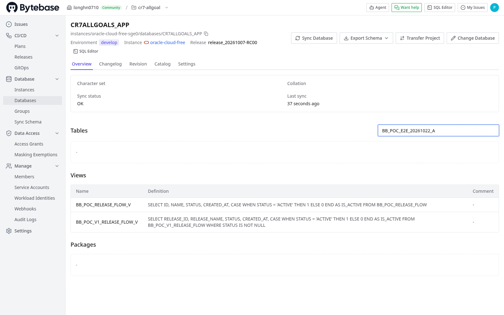

**Thao tác:** Sync Database, tải lại Overview, lọc BB_POC_E2E_20261022_A.

**Quan sát:** Sync status OK; Last sync 37 seconds ago; danh sách Tables với filter tên mới không có bảng khớp.

**Giới hạn:** Catalog là kết quả sync của Bytebase; không gọi ảnh này là kết quả SELECT trực tiếp từ dictionary.

**Lời trình bày:** Metadata vừa đồng bộ chưa có tên bảng dự kiến. Đây là kiểm tra trước rollout, tách khỏi kết quả đối soát sau khi chạy.

### 07 — Edition đang chạy

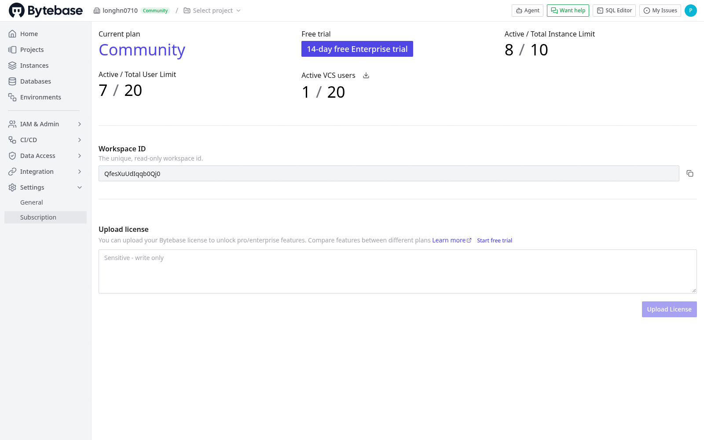

**Thao tác:** Settings → Subscription.

**Quan sát:** Current plan: Community; có lời mời bắt đầu Enterprise trial; phiên khảo sát không kích hoạt trial.

**Giới hạn:** Edition tại lúc xem; không dùng các execution cũ làm bằng chứng edition tại thời điểm cũ.

**Lời trình bày:** Bộ demo được quan sát trên Community, với Home tham chiếu v3.22.1. Không gộp custom approval hay Audit Log trả phí vào kết luận này.

### 09b — SQL cuối tại source SHA cố định

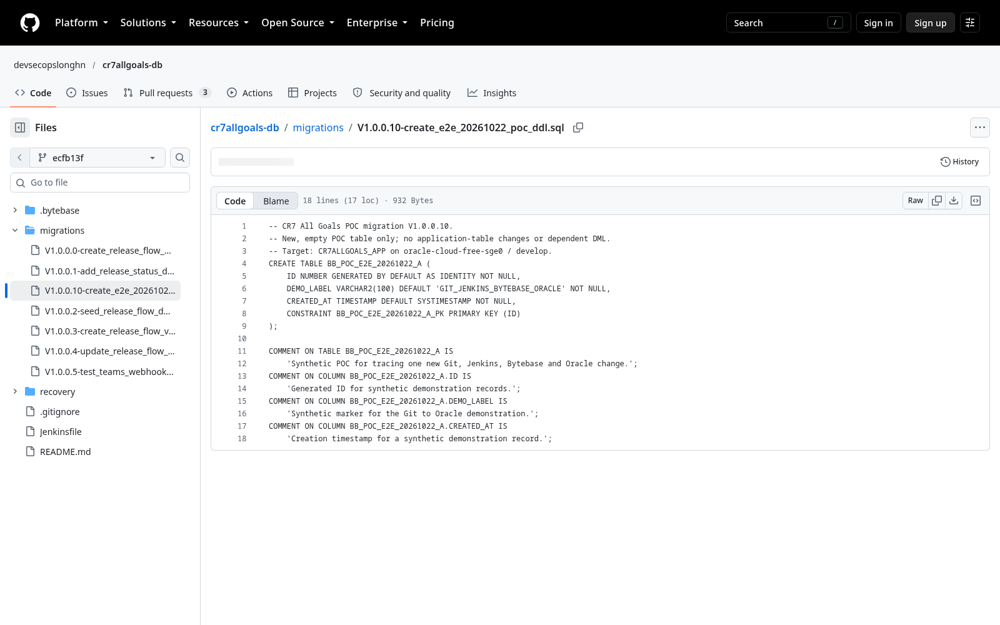

**Thao tác:** GitHub → file V1.0.0.10 tại commit ecfb13f.

**Quan sát:** Bảng BB_POC_E2E_20261022_A, ID identity, primary key, hai cột bổ sung và comments; 932 bytes, không có DML.

**Giới hạn:** Ảnh source không chứng minh execution; nối tiếp bằng build, Release và truy vấn đọc.

**Lời trình bày:** Một file SQL mới có version và source SHA cụ thể. Đây là bản đã được PR-9 #2 review, khác bản đầu bị lỗi comment.

### 10 — PR chính

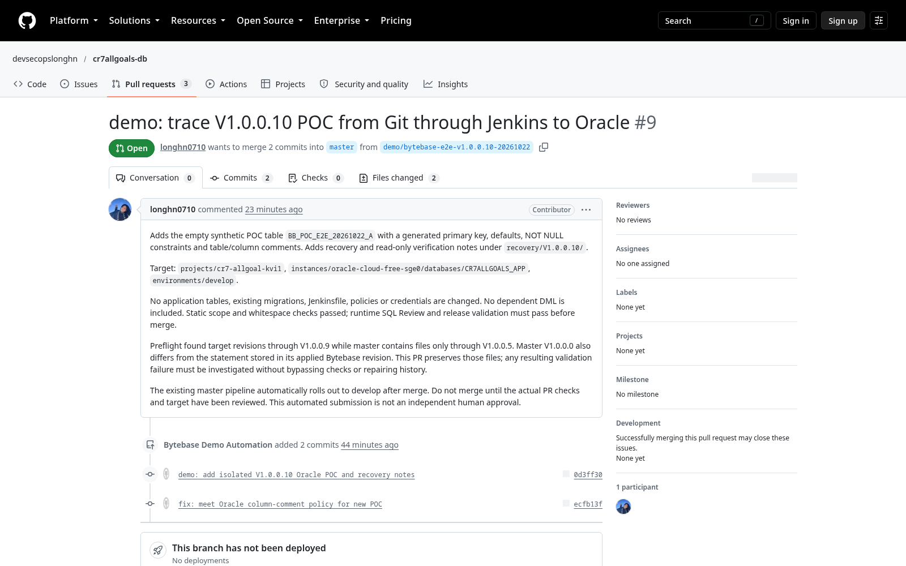

**Thao tác:** Mở PR #9 trên GitHub.

**Quan sát:** PR chính của thay đổi V1.0.0.10, base master, branch demo/bytebase-e2e-v1.0.0.10-20261022; target và recovery được mô tả trong PR.

**Giới hạn:** PR được tạo bằng tài khoản longhn0710 qua GitHub API; ảnh browser public không chứng minh independent approval.

**Lời trình bày:** Một PR riêng quản lý thay đổi POC mới. Các kết quả CI phải gắn với đúng head SHA của từng vòng review.

### 11 — Diff PR trước merge

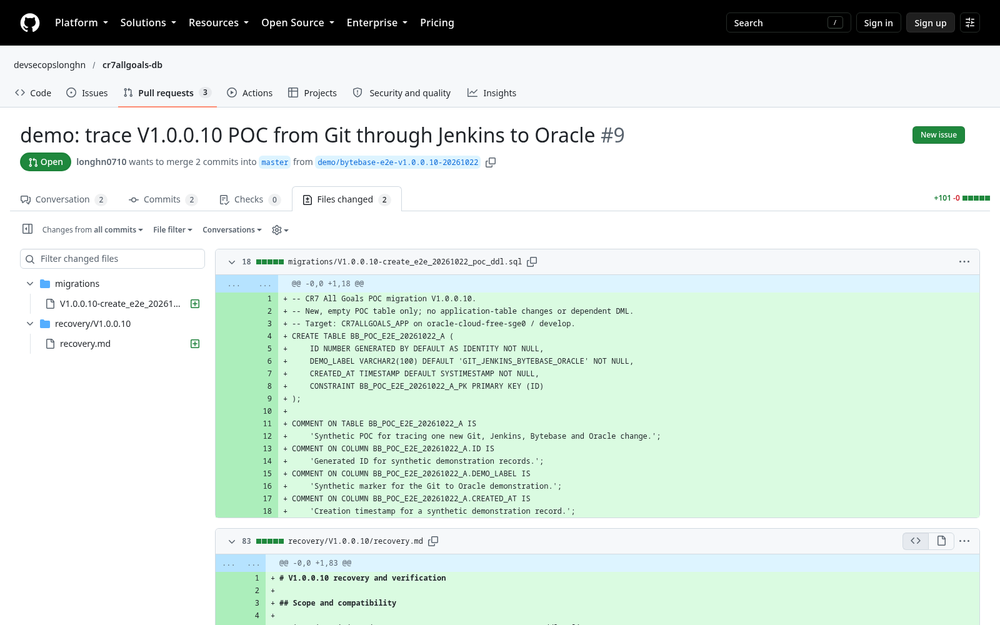

**Thao tác:** PR #9 → Files changed, đợi diff tải đủ.

**Quan sát:** Hai file mới, +101 dòng: migration V1.0.0.10 và recovery notes. SQL có primary key trên ID.

**Giới hạn:** Chụp khi PR còn Open, trước merge; không phải ảnh trạng thái pending của Bytebase.

**Lời trình bày:** Phạm vi thay đổi chỉ thêm POC và recovery notes. Không sửa bảng ứng dụng, migration đã áp dụng, Jenkinsfile hoặc policy.

### 13b — Jenkins checkout bản đã sửa

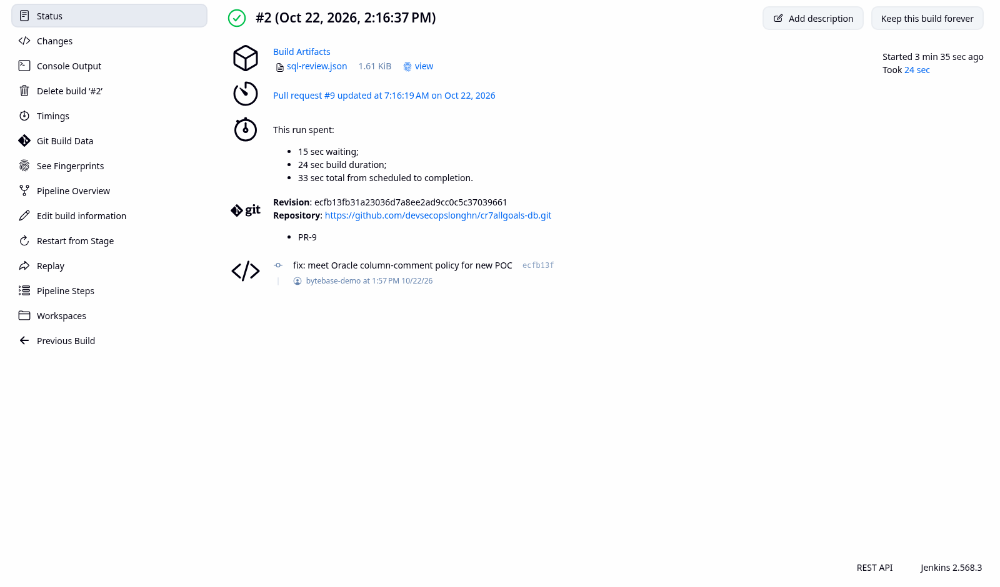

**Thao tác:** Jenkins → PR-9 → build #2.

**Quan sát:** SUCCESS; revision ecfb13fb31a23036d7a8ee2ad9cc0c5c37039661; artifact sql-review.json; cause PR #9 updated.

**Giới hạn:** Thời lượng API 24.904 giây. Build PR không chạy rollout.

**Lời trình bày:** CI tiếp nhận đúng source SHA của PR mới. Kết quả này thuộc PR build, không phải branch build bỏ qua review.

### 13c — SQL Review thực sự chạy trong CI

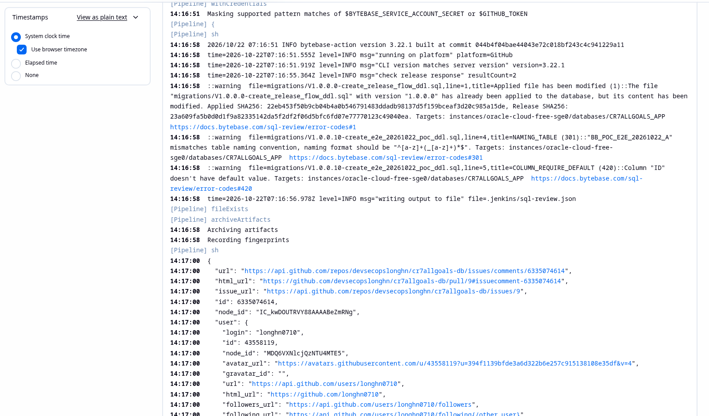

**Thao tác:** Console PR-9 #2 → check release response.

**Quan sát:** Action 3.22.1 báo CLI version matches server version 3.22.1; check trả kết quả đúng CR7ALLGOALS_APP; artifact được archive.

**Giới hạn:** Tên biến secret xuất hiện nhưng không có giá trị. Không dùng thông báo mask để kết luận secret không thể truy xuất.

**Lời trình bày:** Bytebase trả findings qua action; Jenkins chạy lệnh, giữ artifact và đưa trạng thái về GitHub. Đây là check trong CI.

### 14b — Review cuối: 0 lỗi, 3 cảnh báo

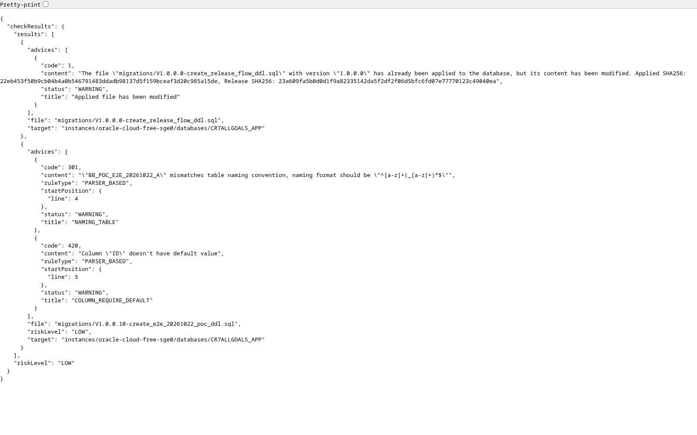

**Thao tác:** Mở artifact JSON gốc của PR-9 #2 trong browser.

**Quan sát:** Không có ERROR; WARNING 1 (V0 đã sửa từ trước), 301 (naming), 420 (identity không được rule coi là default).

**Giới hạn:** Không đổi policy hoặc bỏ check. Không gọi kết quả này là không còn finding.

**Lời trình bày:** FAIL_ON_ERROR hiện có cho phép các cảnh báo này. SQL đã qua check với cảnh báo còn được giữ nguyên để người xem đánh giá.

### 15b — Native comment được action ghi lên PR

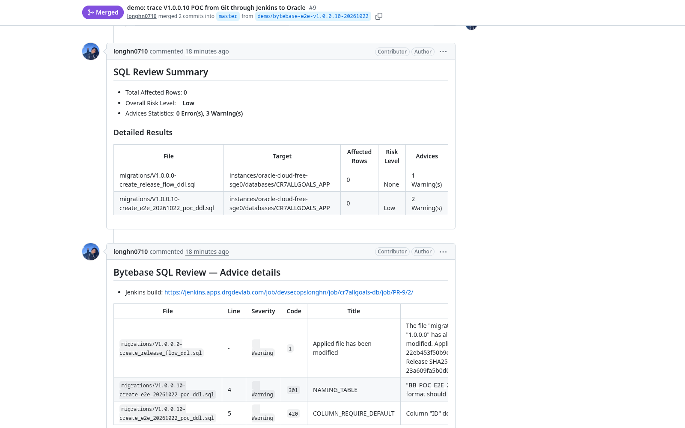

**Thao tác:** PR #9 → comment SQL Review Summary sau build #2.

**Quan sát:** Native summary 0 Error(s), 3 Warning(s), bảng file/target; ngay dưới là comment tích hợp riêng của Jenkins.

**Giới hạn:** Ảnh chụp lại sau merge nên header đã Merged; nội dung comment thuộc PR-9 #2 trước merge. Native comment thực tế cũng có Detailed Results.

**Lời trình bày:** Kết quả review đã được công bố lên PR thật. Comment là đầu ra của action trong CI; không phải một approval của Bytebase UI.

### 15c — Bảng advice do Jenkinsfile tích hợp

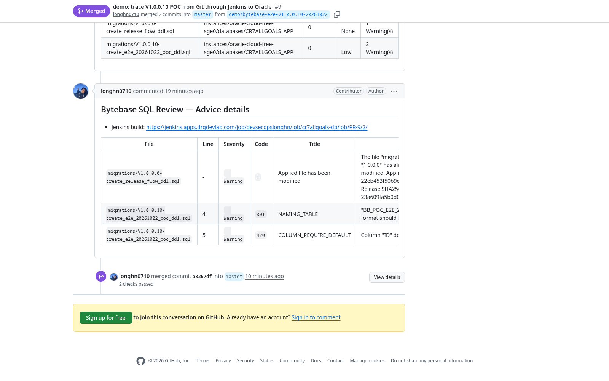

**Thao tác:** PR #9 → Bytebase SQL Review — Advice details.

**Quan sát:** Comment riêng có link PR-9/2, code/severity/file/line và nội dung warning.

**Giới hạn:** Bảng GitHub có vùng ngang giới hạn; artifact JSON ở ảnh 14b lưu nội dung đầy đủ. Cùng tài khoản ghi comment không phải reviewer độc lập.

**Lời trình bày:** Findings do Bytebase trả; Jenkinsfile chuyển artifact thành bảng và upsert comment qua GitHub API. Không gán toàn bộ phần trình bày này cho Bytebase UI.

### 16b — Điều kiện trước quyết định merge

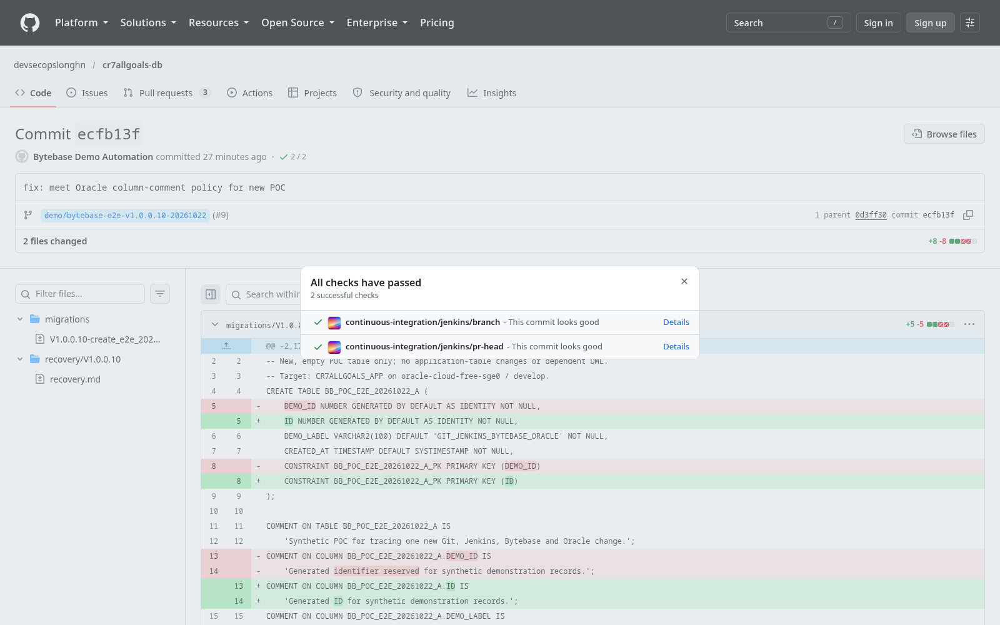

**Thao tác:** Commit ecfb13f → popup Status checks, trước merge.

**Quan sát:** All checks have passed; jenkins/pr-head và jenkins/branch đều success.

**Giới hạn:** Checks xanh không tự chứng minh branch protection. master protected:false; active rules []; reviews [].

**Lời trình bày:** Chỉ merge sau khi check của đúng head SHA thành công. API trước merge cũng xác nhận mergeable clean, không có review yêu cầu hoặc branch rule đang áp dụng.

### 17 — PR mới đã merge

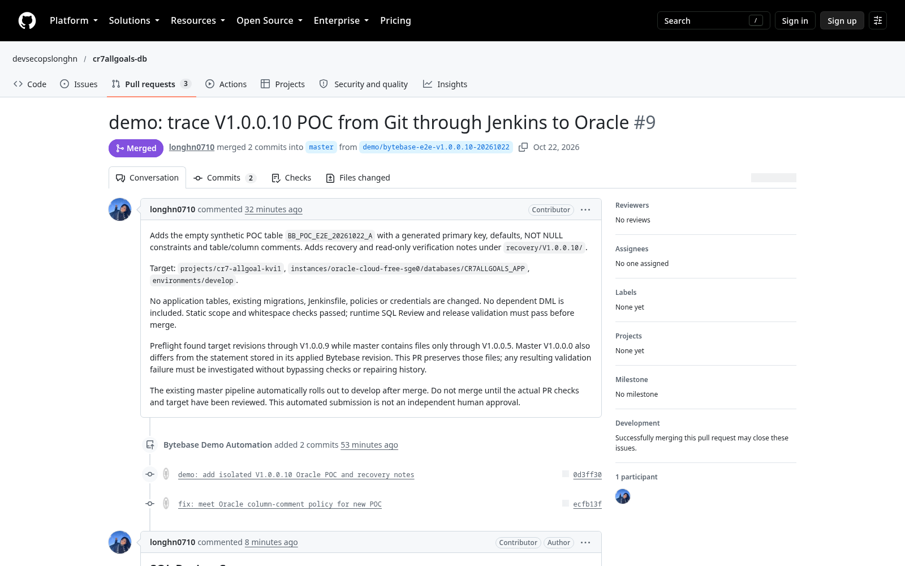

**Thao tác:** Mở lại PR #9 sau normal merge bằng exact head SHA.

**Quan sát:** PR #9 Merged vào master; merge SHA a8267df4c8b097b67fa4b6e88da8bf82e8146d0c.

**Giới hạn:** GitHub account có quyền admin/push; không dùng bypass flag. Không có independent approval được cấu hình/chứng minh.

**Lời trình bày:** Đây là quyết định merge thực tế sau CI thành công, dùng quyền đã được cấp. Không tạo approval độc lập bằng cùng danh tính.

### 18 — Build master mới nhận merge SHA

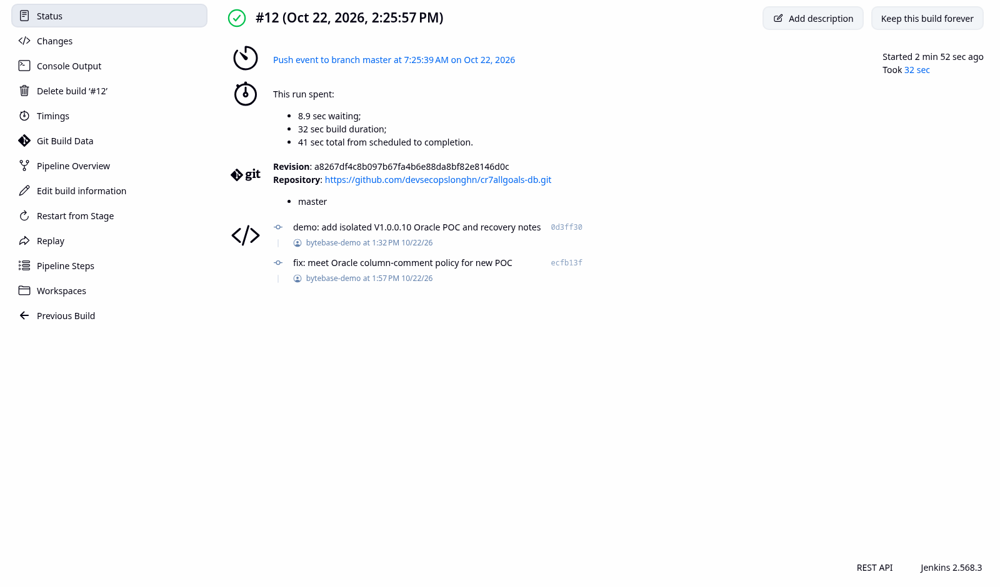

**Thao tác:** Jenkins → master → build #12.

**Quan sát:** Push event master; SUCCESS; Revision a8267df4c8b097b67fa4b6e88da8bf82e8146d0c; liệt kê hai commit mới của PR #9.

**Giới hạn:** Build kéo dài 32.707 giây theo API. SQL Review chỉ chạy ở PR; master sử dụng nội dung SQL đã đối chiếu byte.

**Lời trình bày:** Webhook hiện có đưa commit đã merge vào đúng build triển khai. Không ghép build master cũ với SQL mới.

### 19 — Liên kết build tới Bytebase

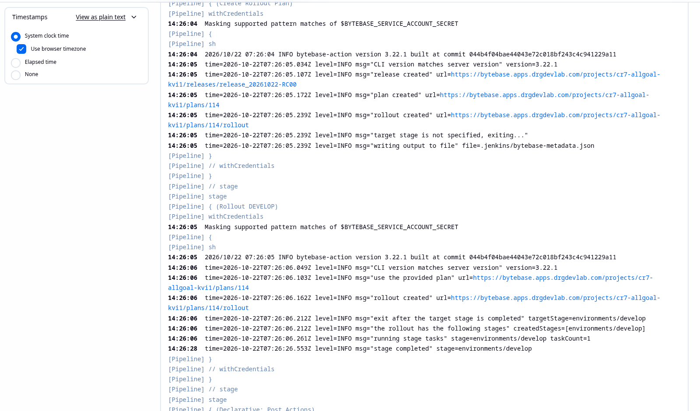

**Thao tác:** Console master #12 → Create Rollout Plan và Rollout DEVELOP.

**Quan sát:** Tạo release_20261022-RC00, Plan 114, rollout; chạy 1 task develop; stage completed lúc 07:26:26.553Z.

**Giới hạn:** Không chụp được trạng thái Plan trước chạy vì luồng tự động quá nhanh. Không retry, chạy lại hoặc thêm gate để lấy ảnh.

**Lời trình bày:** Console thật nối Jenkins build với Release và Plan. Pipeline tự chạy develop sau merge, không có bước người bấm deploy.

### 21 — SQL trong Release trùng bản đã review

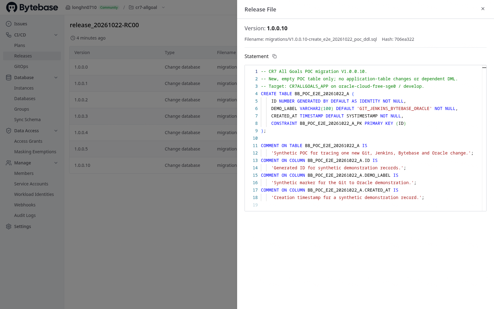

**Thao tác:** Release release_20261022-RC00 → Detail của file 1.0.0.10.

**Quan sát:** Release File có version, filename, hash 706ea322 và SQL tạo đúng bảng POC. GetSheet thực tế trả 932 bytes.

**Giới hạn:** Không thấy Git/commit link native trong màn hình Release/Plan đã mở. Nối nguồn bằng SHA/hash và link ở Jenkins, không dựng link giả.

**Lời trình bày:** SQL source, SQL sau merge và Sheet trong Release giống nhau từng byte; SHA-256 đầy đủ được ghi trong results. Điều này nối review với nội dung triển khai.

### 22 — Rollout mới hoàn tất trên target

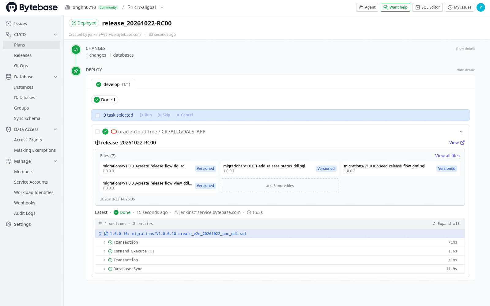

**Thao tác:** Plan 114 → rollout.

**Quan sát:** Deployed; develop 1/1 Done; oracle-cloud-free / CR7ALLGOALS_APP; creator và task identity jenkins@service.bytebase.com; trace chỉ có version 1.0.0.10.

**Giới hạn:** Task 114, task run 113 được lấy từ response thật của browser. Task success cần đối soát bằng query Oracle, không thay cho ảnh 25.

**Lời trình bày:** Bytebase lưu target, danh tính CI, trạng thái và thời gian lần thực thi mới. Release có 7 file nhưng trace lần chạy này chỉ thực thi migration V10.

### 23 — Chi tiết task mới

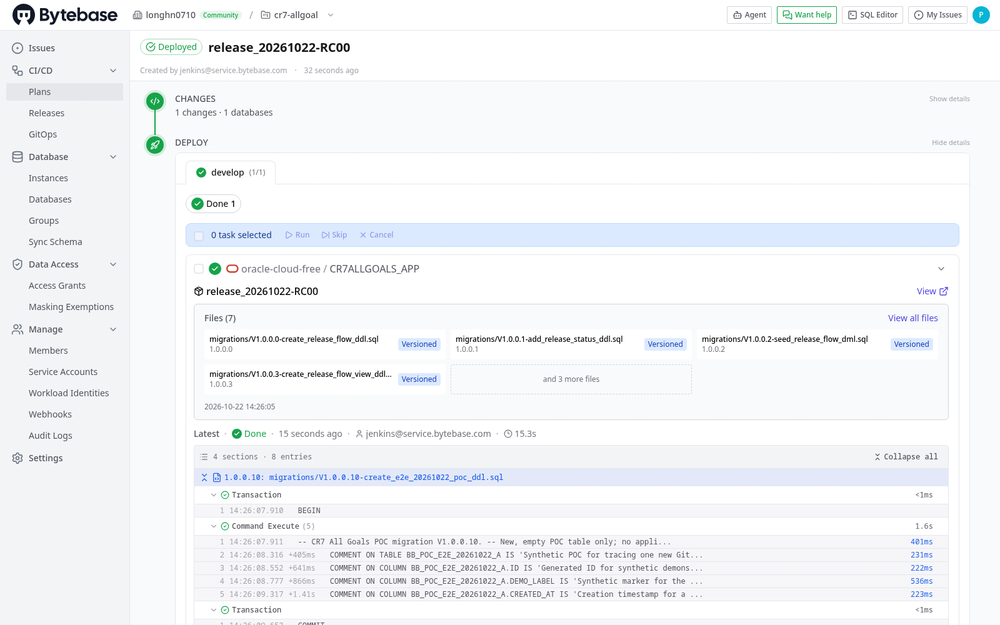

**Thao tác:** Plan 114 → Expand all trong task trace.

**Quan sát:** V1.0.0.10 có 5 Command Execute: CREATE TABLE và 4 COMMENT; BEGIN/COMMIT và Database Sync; tổng task khoảng 15.3 giây.

**Giới hạn:** Nhãn Transaction/COMMIT là trace được UI trình bày; không suy ra Oracle DDL có thể rollback nguyên khối.

**Lời trình bày:** Có thể xem thao tác và thời điểm nền tảng lưu cho task đã chạy. Các entry này thuộc task mới, không phải console CI toàn phần.

### 25 — Đối soát bằng query Oracle mới

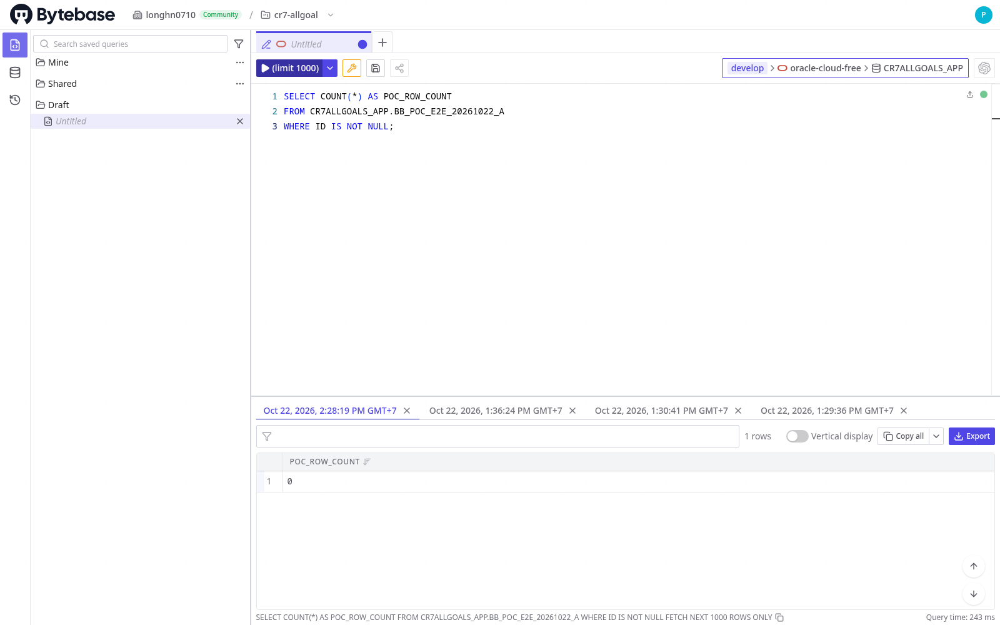

**Thao tác:** SQL Editor đúng develop / oracle-cloud-free / CR7ALLGOALS_APP → SELECT COUNT(*) từ BB_POC_E2E_20261022_A WHERE ID IS NOT NULL.

**Quan sát:** POC_ROW_COUNT = 0; thời điểm query 2026-10-22 14:28:19 GMT+7; query time 243 ms.

**Giới hạn:** Query chạy qua Bytebase tới Oracle, không có client Oracle độc lập. Không dùng row count estimate của catalog thay cho kết quả query.

**Lời trình bày:** Một truy vấn đọc mới thành công trên đúng bảng vừa tạo xác nhận object có thể truy cập ở target. Bảng rỗng đúng chủ đích không thêm DML.

### 26 — Catalog sau deployment

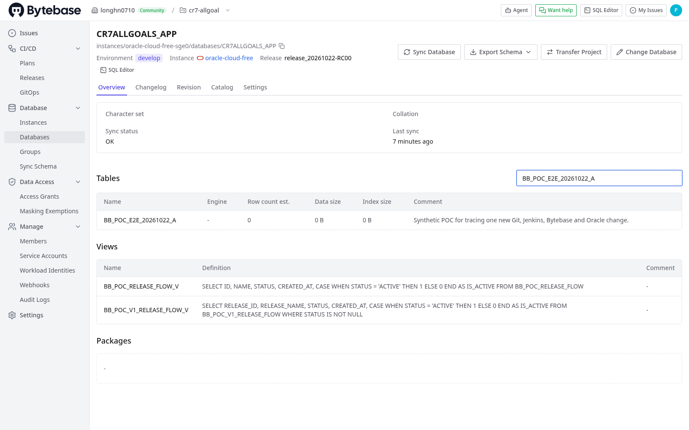

**Thao tác:** Database Overview → lọc đúng tên bảng mới.

**Quan sát:** Release hiện tại release_20261022-RC00; Sync OK; bảng BB_POC_E2E_20261022_A và comment xuất hiện, row count estimate 0.

**Giới hạn:** Metadata đồng bộ là bằng chứng bổ sung; count 0 trực tiếp nằm ở ảnh 25.

**Lời trình bày:** Catalog sau sync có object mới, đối chiếu được với ảnh trước chạy không có bảng. Target và Release luôn hiển thị cùng nhau.

### 27 — Cột, default và index của POC

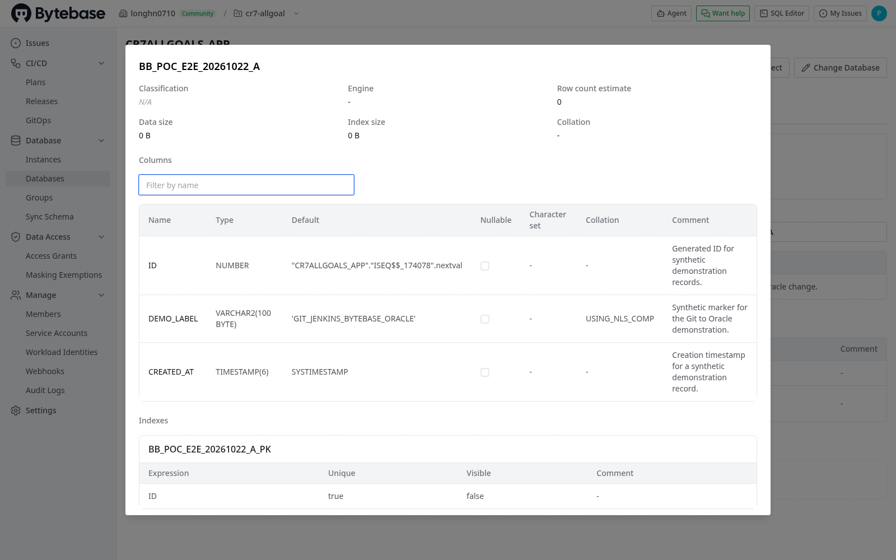

**Thao tác:** Từ catalog mở chi tiết bảng BB_POC_E2E_20261022_A.

**Quan sát:** Ba cột ID/DEMO_LABEL/CREATED_AT, defaults/comments; Nullable không bật; index BB_POC_E2E_20261022_A_PK trên ID, Unique true.

**Giới hạn:** Ảnh mô tả metadata, không phải bài thử constraint bằng DML. Không khẳng định đã thử INSERT hoặc enforcement bằng tài khoản ít quyền.

**Lời trình bày:** Schema metadata phản ánh cấu trúc vừa khai báo. Oracle hiển thị identity của ID bằng sequence hệ thống tự sinh.

### 28 — Tìm lại từ project sau execution

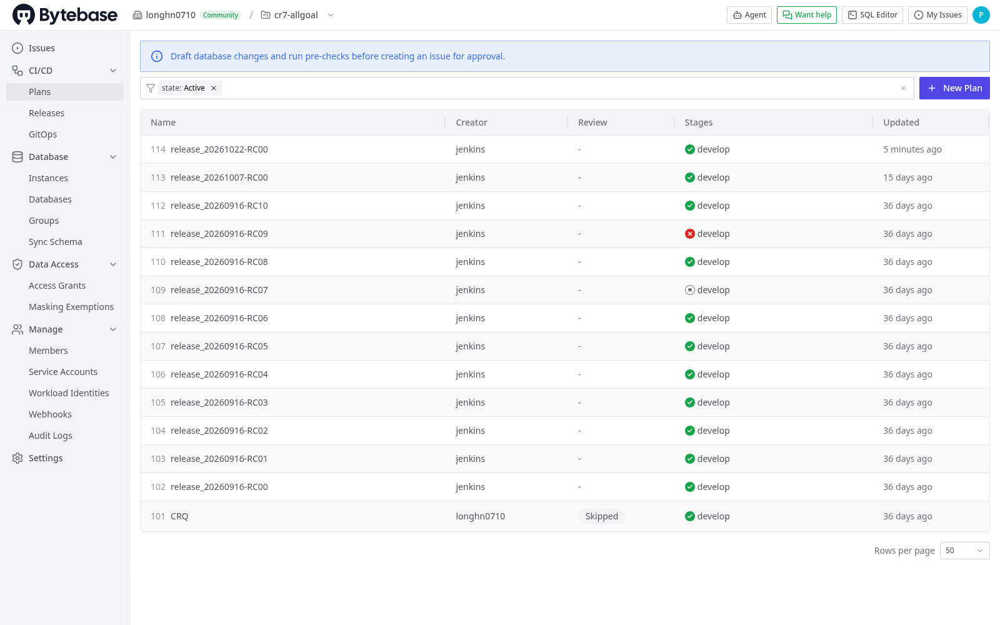

**Thao tác:** Rời trang execution → menu Plans của project.

**Quan sát:** Danh sách có Plan 114 / release_20261022-RC00, creator jenkins, stage develop xanh; các Plan cũ ở dòng riêng.

**Giới hạn:** Review column của Plan Release hiển thị dấu gạch; không gán review CI thành human approval ở màn hình này.

**Lời trình bày:** Thay đổi mới vẫn tra cứu được từ project khi build đã kết thúc. Plan 113 cũ không được dùng thay kết quả này.

### 29 — Mở lại đúng Plan 114

**Thao tác:** Từ dòng Plan 114 trong danh sách, mở lại Plan.

**Quan sát:** URL /plans/114; Deployed, đúng Release, target, creator, timestamp và task trace 1.0.0.10 vẫn còn.

**Giới hạn:** Task history không tự tương đương Audit Log đầy đủ; không khẳng định Bytebase giữ toàn bộ console Jenkins.

**Lời trình bày:** Có thể lần ngược kết quả thực thi mới sau khi job không còn chạy. Kết hợp Release File để đọc SQL và Jenkins console để nối nguồn Git.

### 30 — Revision mới tại database

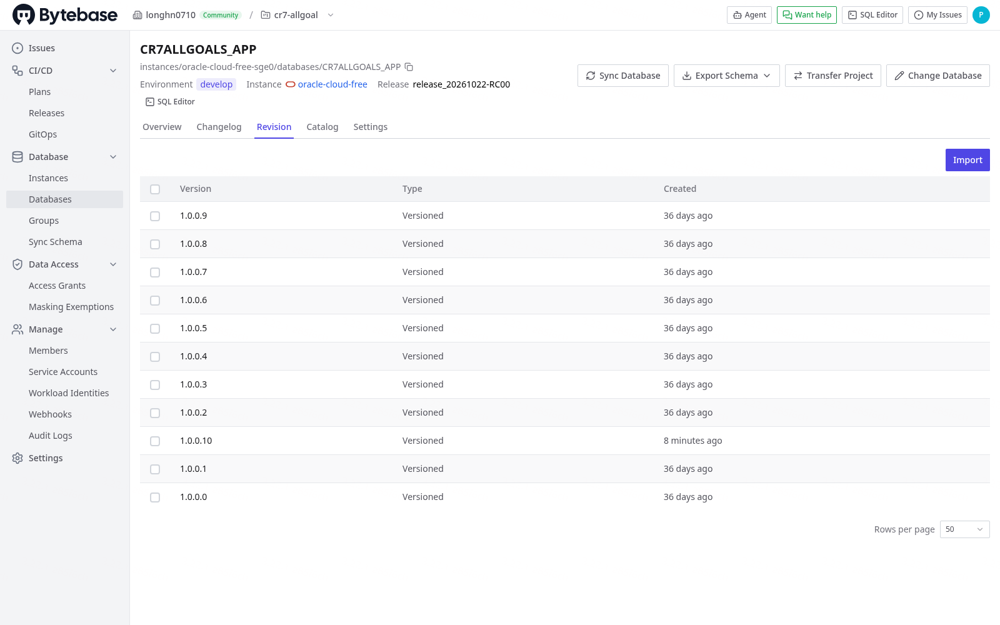

**Thao tác:** Database CR7ALLGOALS_APP → Revision.

**Quan sát:** Version 1.0.0.10 mới xuất hiện, thời gian mới; các version 0–9 cũ vẫn có.

**Giới hạn:** Danh sách UI đang sắp theo chuỗi nên 1.0.0.10 nằm giữa 1.0.0.2 và 1.0.0.1; không nhầm là chạy lại version cũ.

**Lời trình bày:** History của target ghi thêm version vừa triển khai. Version được chọn theo trạng thái database, không chỉ theo file cao nhất trên master.

## Ca SQL vi phạm — chỉ review, không deploy

### 80 — Ca âm riêng: thiếu primary key

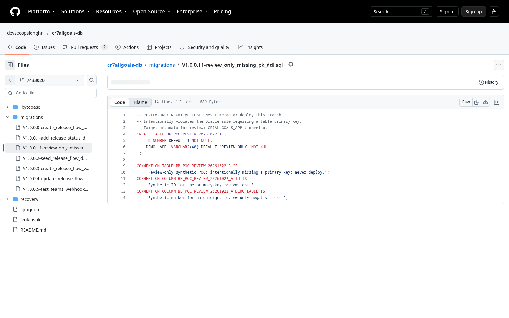

**Thao tác:** GitHub → V1.0.0.11 tại SHA 7433020.

**Quan sát:** Bảng BB_POC_REVIEW_20261022_A cố ý không khai báo primary key; source ghi rõ REVIEW-ONLY, never merge/deploy.

**Giới hạn:** Không merge hoặc deploy; version V11 trong PR không có nghĩa database đã áp dụng V11.

**Lời trình bày:** Một PR riêng dùng để kiểm chứng finding Oracle đang bật. SQL này không nằm trong Release của luồng chính.

### 81 — CI thất bại cho đúng ca âm

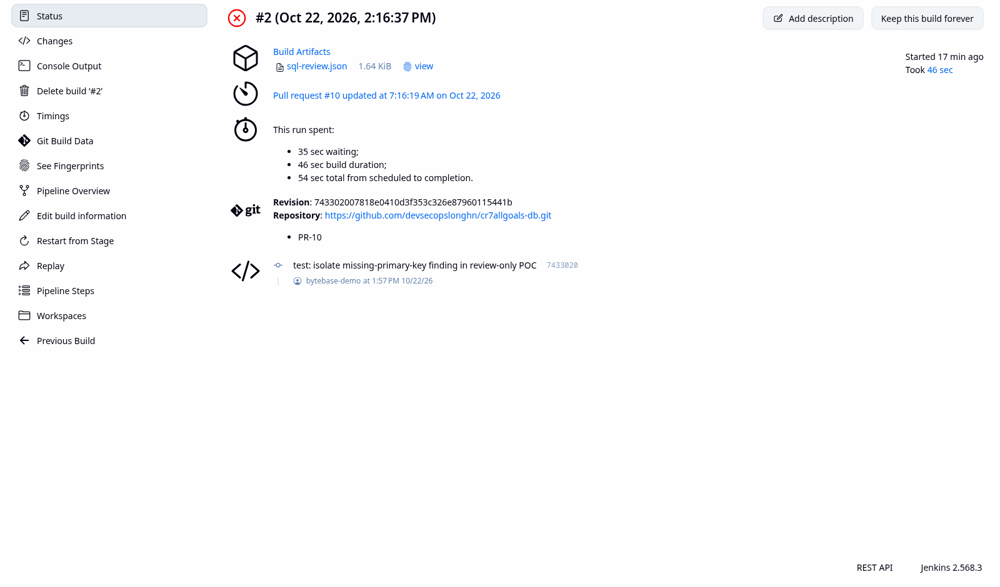

**Thao tác:** Jenkins → PR-10 → build #2.

**Quan sát:** FAILURE; checkout 743302007818e0410d3f353c326e87960115441b; artifact sql-review.json.

**Giới hạn:** CI failure được phân biệt với Git cưỡng chế cấm merge; không thử merge PR này.

**Lời trình bày:** Build thực tế thất bại trên SHA có SQL thiếu PK. Các stage master-only không chạy trong PR build.

### 82b — Finding cuối cô lập lỗi PK

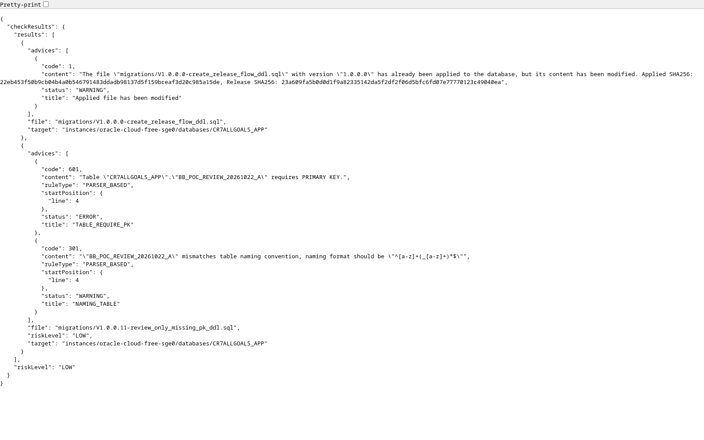

**Thao tác:** Mở artifact gốc PR-10 #2.

**Quan sát:** 1 ERROR TABLE_REQUIRE_PK 601, line 4; 2 WARNING gồm V0 modified và naming. Không còn ERROR comment dài.

**Giới hạn:** Finding do Bytebase trả trong check CI. Không gọi là một runtime migration failure hoặc approval UI.

**Lời trình bày:** Rule trả lỗi thiếu PRIMARY KEY cho đúng target Oracle. Không thay policy để có kết quả này.

### 83 — PR nhận findings của ca âm

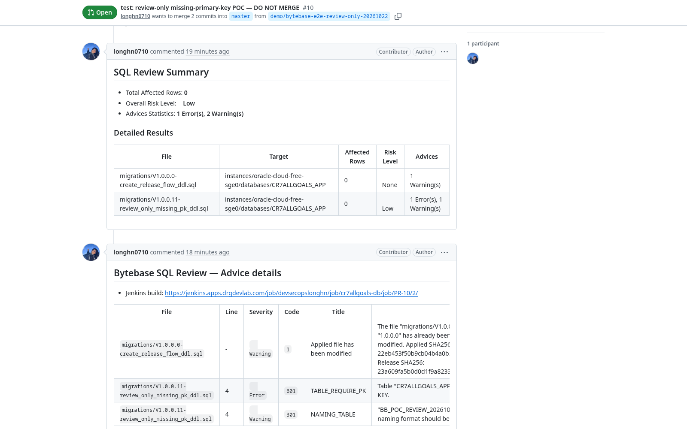

**Thao tác:** PR #10 → native summary và comment advice của Jenkins.

**Quan sát:** 1 Error(s), 2 Warning(s); comment riêng có link PR-10/2 và code 601; PR vẫn Open / DO NOT MERGE.

**Giới hạn:** Cùng danh tính ghi comment/PR; không giả independent approval, không suy merge enforcement từ comment.

**Lời trình bày:** Kết quả lỗi đã lên PR thật qua CI. Reviewer có thông tin để quyết định, trong khi phiên này chủ động giữ PR chưa merge.

### 84 — Git nhận check lỗi của ca âm

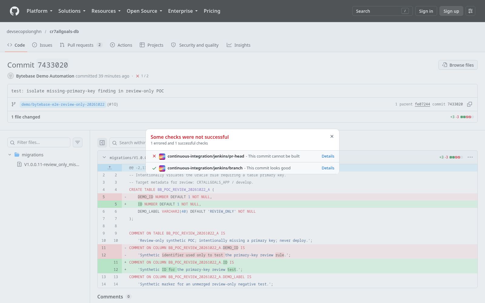

**Thao tác:** Commit 7433020 → Status checks.

**Quan sát:** Some checks were not successful: PR-head lỗi trong khi branch build thành công.

**Giới hạn:** master không protected, rules trống khi kiểm tra; ảnh này không chứng minh Git cưỡng chế chặn merge.

**Lời trình bày:** GitHub nhận trạng thái CI lỗi. Branch build xanh vẫn không thay thế SQL Review ở PR.

### 85 — Lệnh check báo lỗi thật

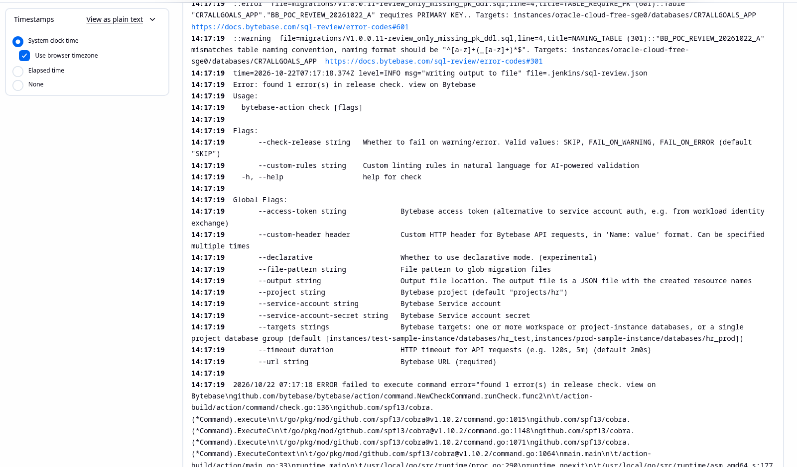

**Thao tác:** Console PR-10 #2 → found 1 error(s) in release check.

**Quan sát:** Action báo found 1 error(s), failed to execute command; kết quả build cuối FAILURE.

**Giới hạn:** Không chạy lại hoặc retry migration. Nội dung help chỉ là tên tham số, không có giá trị token/secret.

**Lời trình bày:** Lỗi review làm CI thất bại theo FAIL_ON_ERROR. Đây là hành vi lệnh check, không phải cố deploy SQL vi phạm để tạo lỗi.

## Phụ lục: chuẩn bị và vòng review đầu của cùng thay đổi

### 03a — Giới hạn của truy vấn dictionary

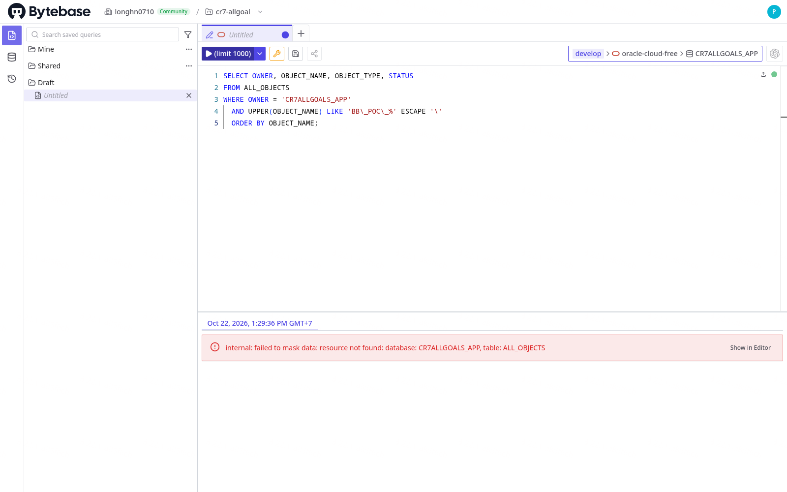

**Thao tác:** SQL Editor trên đúng target → SELECT metadata ALL_OBJECTS chỉ lọc POC.

**Quan sát:** Bytebase báo failed to mask data / resource not found / table ALL_OBJECTS. Truy vấn COUNT trên ALL_OBJECTS cũng gặp lỗi.

**Giới hạn:** Không có kết quả xác nhận tên bảng mới từ truy vấn này. Không thay masking hoặc quyền DB để vượt lỗi.

**Lời trình bày:** Đường truy vấn dictionary này chưa trả được kết quả qua lớp metadata/masking. Không suy ra Oracle mất kết nối hoặc không hỗ trợ truy vấn đọc.

### 04 — SQL local của vòng review đầu

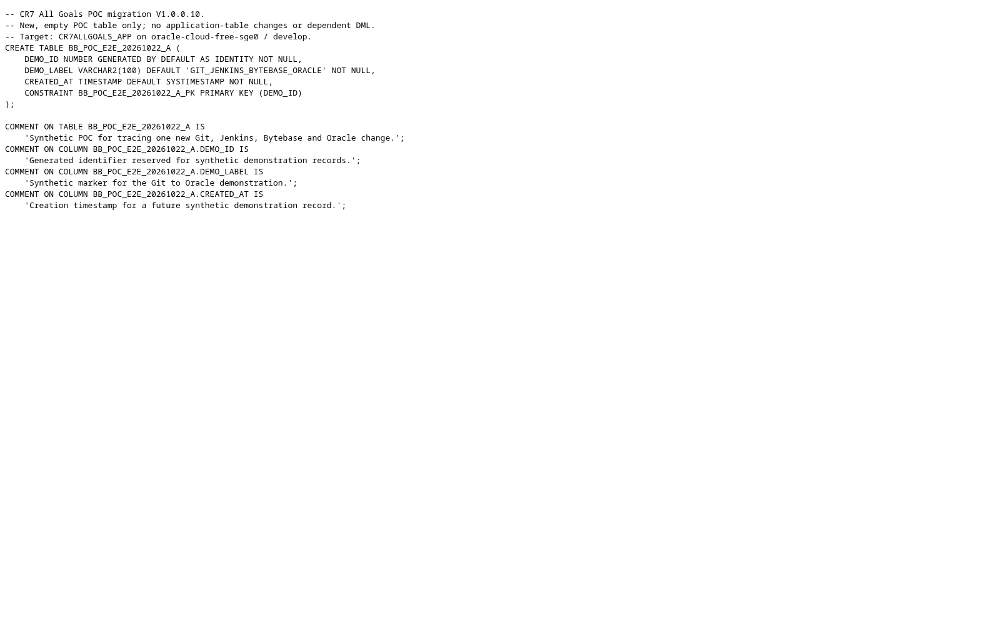

**Thao tác:** Browser mở bản text có cùng bytes với file migration local ban đầu.

**Quan sát:** V1.0.0.10 thêm bảng POC mới, primary key, defaults và comments; không có DML phụ thuộc bảng mới.

**Giới hạn:** Ảnh plaintext local, không phải giao diện GitHub hay kết quả thực thi.

**Lời trình bày:** Đây là bản SQL đầu tiên của cùng thay đổi, trước khi CI phát hiện comment quá dài. Bản được merge phải đối chiếu theo SHA cuối, không dùng ảnh này thay cho bản đã sửa.

### 05 — Commit và diff local ban đầu

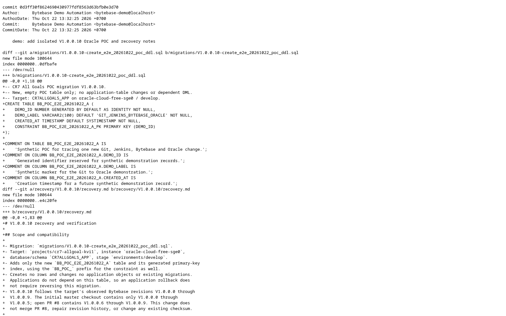

**Thao tác:** Browser mở nguyên văn output git show --format=fuller HEAD tại lúc tạo commit đầu.

**Quan sát:** Commit 0d3ff30 thêm migration và recovery notes; author/committer là Bytebase Demo Automation / localhost.

**Giới hạn:** Output Git thật được browser hiển thị dạng text; source SHA vòng đầu 0d3ff30 khác source SHA cuối ecfb13f đã qua PR-9 #2 và được merge.

**Lời trình bày:** Diff chỉ thêm object POC và ghi chú recovery. Danh tính automation trong commit không phải một reviewer độc lập.

### 06 — Recovery notes

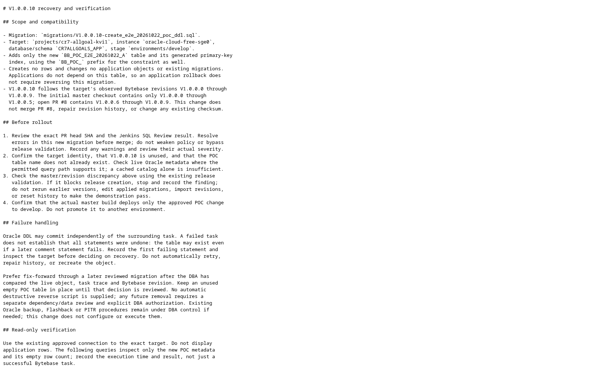

**Thao tác:** Browser mở nguyên văn recovery/V1.0.0.10/recovery.md của vòng đầu.

**Quan sát:** Ghi target, phạm vi bảng rỗng, kiểm tra trước chạy, fix-forward và giới hạn rollback DDL; có truy vấn đối soát.

**Giới hạn:** Đây là ghi chú source; chưa chứng minh một lần recovery đã được thực hiện.

**Lời trình bày:** Recovery được chuẩn bị cùng SQL để reviewer biết cách xử lý nếu task thất bại. Không có lệnh reverse tự động hoặc thử DROP/TRUNCATE.

### 08 — Truy vấn Oracle trước thay đổi

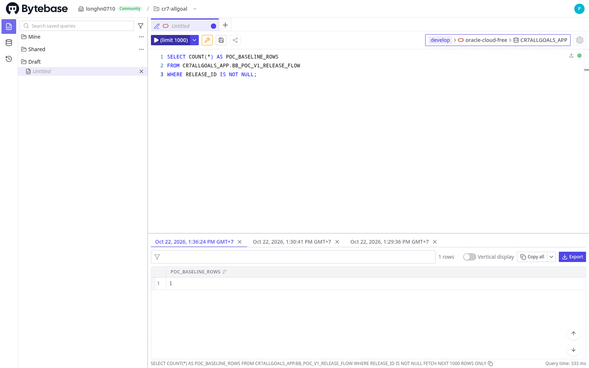

**Thao tác:** SQL Editor → COUNT(*) trên CR7ALLGOALS_APP.BB_POC_V1_RELEASE_FLOW với WHERE RELEASE_ID IS NOT NULL.

**Quan sát:** POC_BASELINE_ROWS = 1; query time 333 ms; đúng target develop / Oracle / CR7ALLGOALS_APP.

**Giới hạn:** Chỉ đếm dữ liệu tổng hợp POC cũ, không đọc hàng nghiệp vụ hoặc chứng minh V1.0.0.10 đã chạy.

**Lời trình bày:** Một truy vấn đọc mới trên bảng POC đã có hoạt động. Điều này khác với truy vấn dictionary bị lỗi và chưa phải kết quả triển khai bảng mới.

### 09a — Source GitHub của vòng đầu

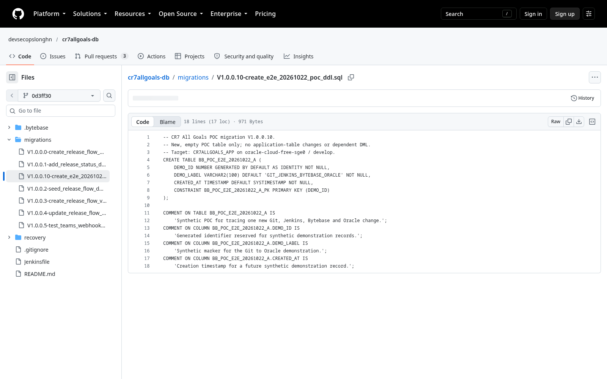

**Thao tác:** Mở file migration tại commit 0d3ff30 trên GitHub.

**Quan sát:** File migration mới đã được push vào repo; URL dùng SHA cố định.

**Giới hạn:** Source vòng đầu 0d3ff30; bản cuối đã được cập nhật tại ecfb13f, xem ảnh 09b/11 và kết quả PR-9 #2.

**Lời trình bày:** SQL đã có nguồn Git cụ thể và có thể nối tới Jenkins PR-9 #1. Vòng sau sửa SQL chưa áp dụng phải được nối bằng SHA mới.

### 13a — CI nhận đúng source SHA đầu tiên

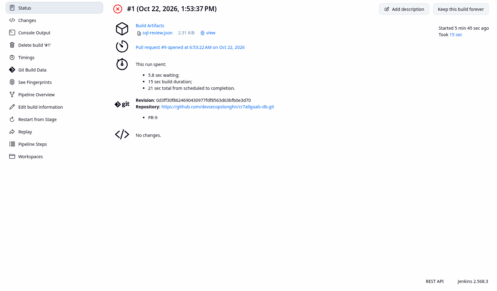

**Thao tác:** Jenkins → PR-9 → build #1.

**Quan sát:** Cause Pull request #9 opened; Revision 0d3ff30; artifact sql-review.json; result FAILURE.

**Giới hạn:** Build vòng đầu; branch build xanh không thay thế PR SQL Review. Không có rollout trong build PR.

**Lời trình bày:** Jenkins đã checkout đúng commit của PR mới. Build thất bại có artifact để phân tích, không phải một lần chạy lịch sử ghép với SQL mới.

### 14a — Finding đầu tiên của PR chính

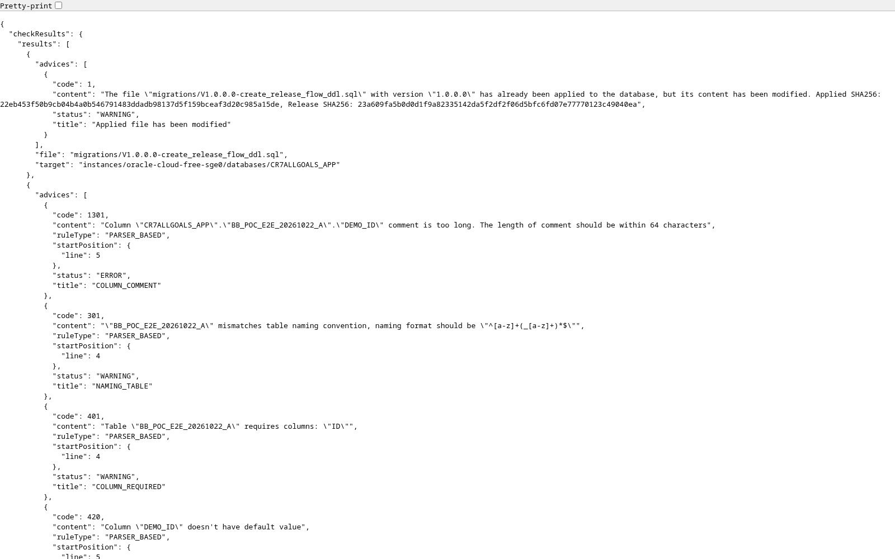

**Thao tác:** Mở trực tiếp artifact sql-review.json do Jenkins lưu từ Bytebase action.

**Quan sát:** COLUMN_COMMENT 1301 ERROR: comment DEMO_ID dài quá 64 ký tự. Cùng artifact có V0 modified warning và các naming/column warnings.

**Giới hạn:** V0 content mismatch là WARNING trong kết quả thực tế, không phải ERROR chặn lần này. Artifact không phải comment do Jenkinsfile dựng.

**Lời trình bày:** Bytebase trả finding có code, severity, file, dòng và target. SQL mới được sửa sau review thay vì đổi policy cho qua.

### 15a — Blocker tích hợp comment

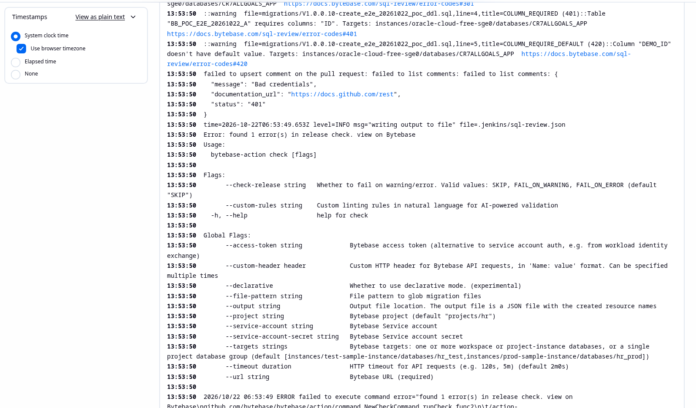

**Thao tác:** Mở Console Output của PR-9 #1 tại lỗi GitHub.

**Quan sát:** Native comment upsert báo Bad credentials / HTTP 401; bước curl comment chi tiết cũng trả 401. Artifact review vẫn được lưu.

**Giới hạn:** Lỗi tích hợp ở vòng đầu. Sau khi người dùng cho phép, duy nhất Global Secret text github-token được cập nhật; vòng #2 ghi comment thành công. Không chụp form hoặc giá trị credential.

**Lời trình bày:** Kết quả SQL Review đã có nhưng bước trình bày lên PR đang lỗi credential tích hợp. Lỗi cấu hình comment khác với finding SQL và không được gọi là sản phẩm không hỗ trợ.

### 16a — Git nhận trạng thái CI đầu tiên

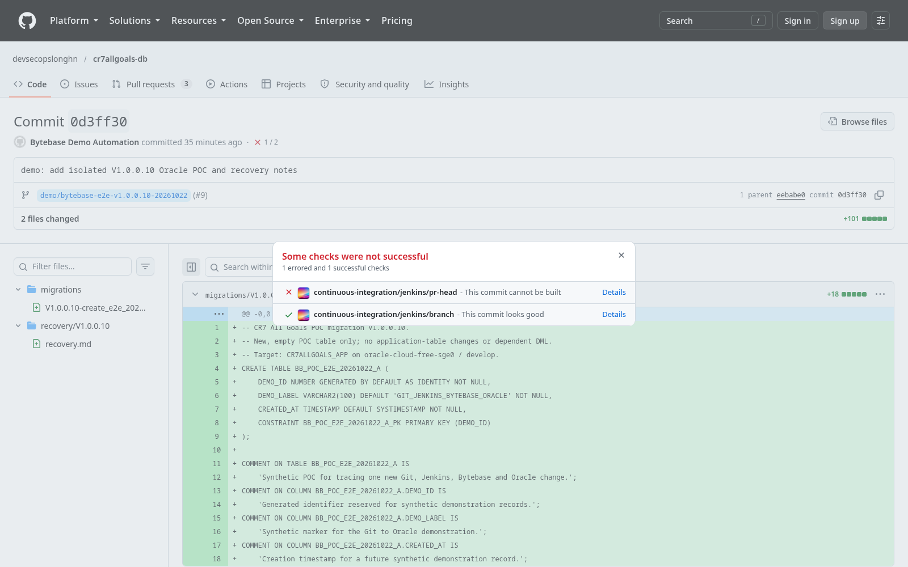

**Thao tác:** Commit 0d3ff30 trên GitHub → Status checks.

**Quan sát:** 1 errored / 1 successful: jenkins/pr-head lỗi, jenkins/branch thành công.

**Giới hạn:** Ảnh badge lỗi không chứng minh Git bắt buộc chặn merge. Public/authenticated API lúc khảo sát trả master protected:false và active rules trống.

**Lời trình bày:** Build branch xanh không chứng minh review PR thành công. GitHub đã nhận check status lỗi từ đúng Jenkins PR build.

### 82a — Ca vi phạm Oracle trên PR riêng

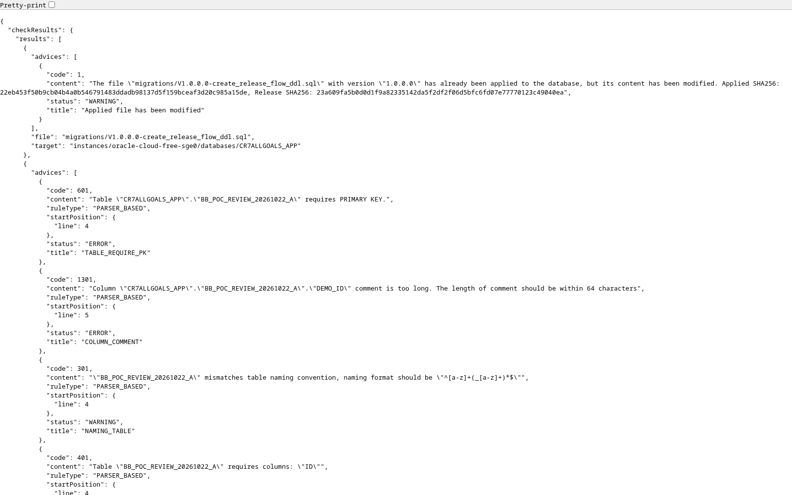

**Thao tác:** Mở artifact PR-10 #1.

**Quan sát:** Vòng đầu PR-10 #1 có TABLE_REQUIRE_PK 601 và COLUMN_COMMENT 1301 ERROR, cùng 3 WARNING. Sau đó sửa riêng comment của SQL chưa áp dụng để vòng #2 còn một lỗi PK.

**Giới hạn:** Phụ lục vòng đầu có hai lỗi. Kết quả cuối dùng PR-10 #2 / SHA 7433020, không deploy cả hai phiên bản.

**Lời trình bày:** Ca review-only trả lỗi thiếu primary key thật. Branch này không được merge hoặc deploy.

Xem [evidence-index.csv](evidence-index.csv), [results.md](results.md) và [slide-notes.md](slide-notes.md).
